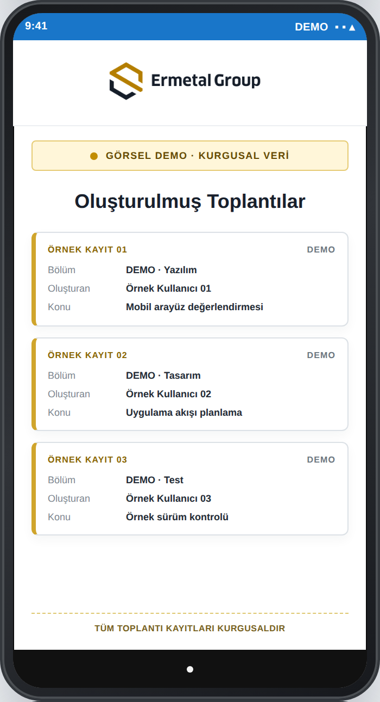
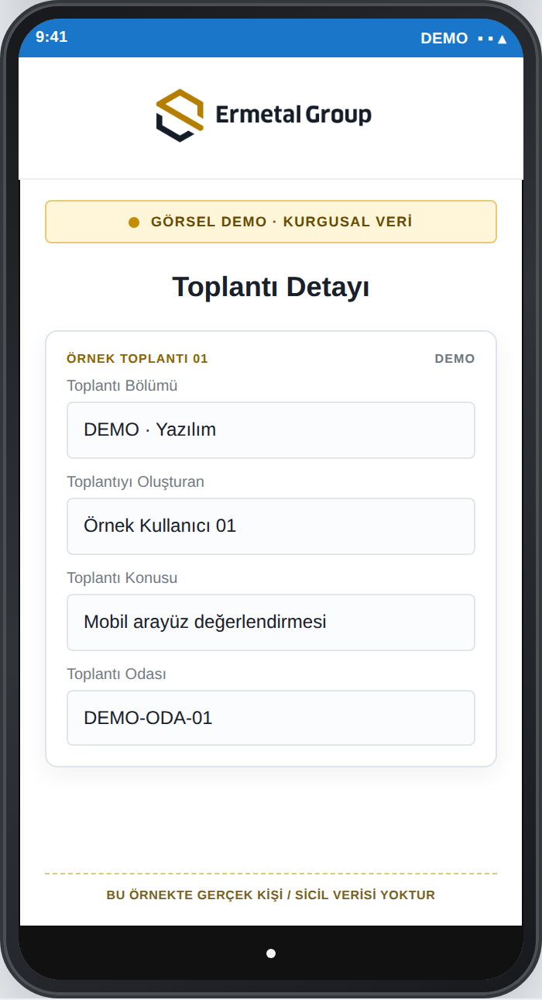
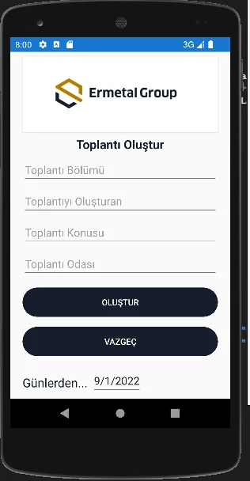
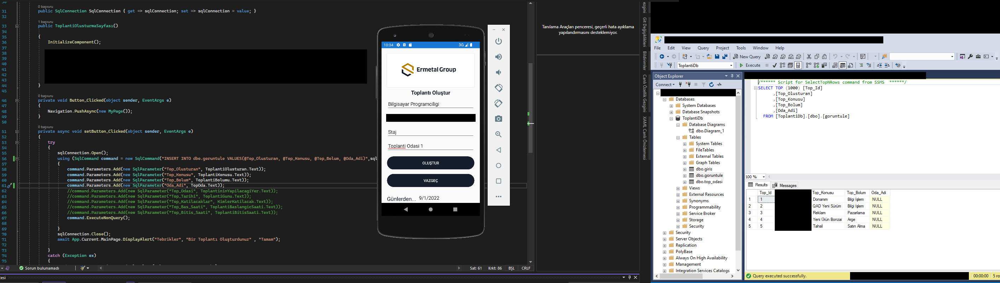
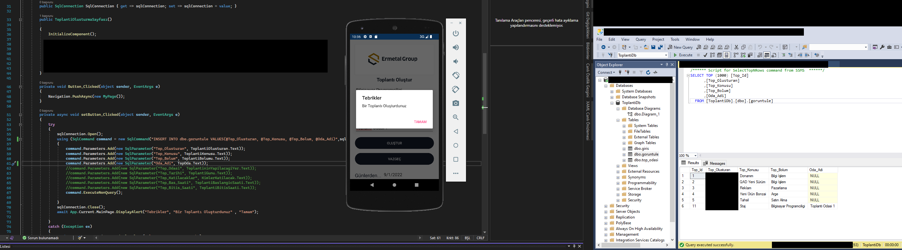

# EGTRS — Toplantı Randevu Sistemi

Ermetal Group bünyesindeki stajım sırasında Xamarin.Forms ve C# ile geliştirdiğim mobil toplantı randevu uygulaması. Android ve iOS projeleri; toplantı oluşturma, kayıtlı toplantıları listeleme ve ayrıntıları görüntüleme akışlarını içerir.

## Öne çıkan özellikler

- Sicil numarası ve parola alanları bulunan giriş ekranı
- Toplantı bölümü, oluşturan kişi, konu ve oda bilgileriyle toplantı oluşturma
- Kayıtlı toplantıları listeleme ve ayrıntıları görüntüleme
- Xamarin.Forms ile ortak mobil arayüz; Android ve iOS proje yapısı

## Teknolojiler

- C# ve Xamarin.Forms 5
- .NET Standard 2.0
- SQL Server istemcisi
- Android ve iOS platform projeleri

## Ekranlar ve geliştirme süreci

Projeden seçilmiş uygulama ve geliştirme görüntüleri:

| Giriş | Toplantı oluşturma | Toplantı listesi |
|---|---|---|
|  |  |  |

| Toplantı ayrıntısı | Toplantı formu |
|---|---|
|  |  |

## Proje yapısı

- `LoginPageSpeedUI/`: Ortak Xamarin.Forms sayfaları ve uygulama akışları
- `LoginPageSpeedUI.Android/`: Android uygulama projesi ve kaynakları
- `LoginPageSpeedUI.iOS/`: iOS uygulama projesi ve kaynakları
- `screenshots/`: Proje ekranları ve geliştirme görüntüleri

## Geliştirme

`LoginPageSpeedUI.sln` dosyasını Xamarin.Forms iş yükleri ve Android araçları kurulu uyumlu bir Visual Studio ortamında açın. iOS derlemesi için Apple geliştirme araçları gerekir. Xamarin artık eski (legacy) bir teknolojidir; yeni uygulamalarda .NET MAUI değerlendirilebilir.

## Güvenlik ve veritabanı

Kaynak paketinde gerçek SQL Server adresi, kullanıcı adı, parola, API anahtarı, token, sertifika veya `.env` dosyası bulunmaz. `LoginPageSpeedUI/ConnectionSettings.cs` içindeki bağlantı alanları `YOUR_SERVER`, `YOUR_USERNAME` ve `YOUR_PASSWORD` yer tutucularıdır. Gerçek kimlik bilgilerini kaynak koda veya mobil uygulama paketine koymayın. Bu prototipte SQL Server'a doğrudan mobil istemciden erişim örneği bulunur; üretim uygulamasında kimlik doğrulamalı ve TLS kullanan bir backend API tercih edilmelidir.
