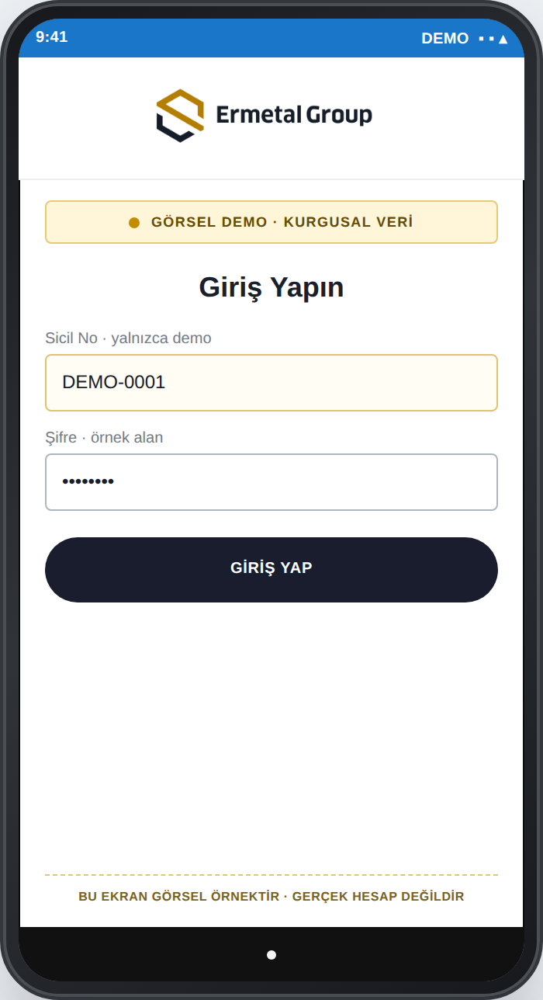
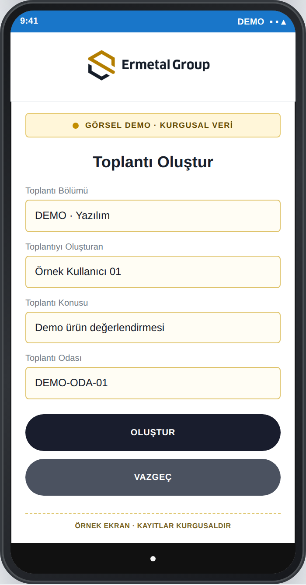
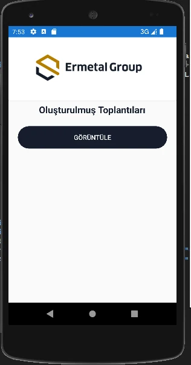
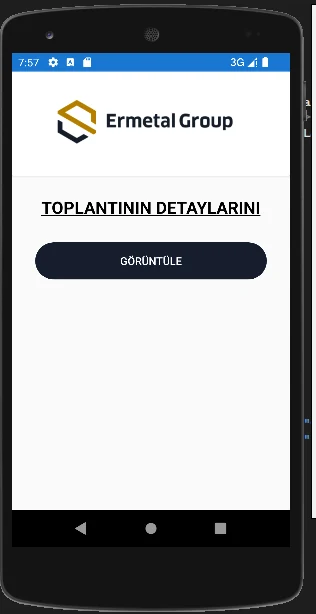

# EGTRS — Toplantı Randevu Sistemi

Xamarin.Forms ile geliştirilmiş, Android ve iOS platform projeleri içeren toplantı randevu uygulaması. Kaynak kod; giriş, toplantı oluşturma ve kayıtlı toplantıları görüntüleme akışlarını içerir.

> Bu repo gerçek bir sunucuya veya canlı veritabanına bağlı değildir. **Görsel demo** dosyaları statik mockup'lardır; içlerinde yalnızca açıkça işaretlenmiş kurgusal örnek kayıtlar bulunur. Gerçek uygulama ekranları ayrıca belirtilmiştir.

## Öne çıkan akışlar

- Sicil numarası ve parola alanlarıyla giriş ekranı
- Toplantı bölümü, oluşturan kişi, konu ve oda bilgileriyle toplantı oluşturma
- Kayıtlı toplantıları listeleme ve toplantı ayrıntılarını görüntüleme
- Xamarin.Forms ile ortak mobil arayüz; Android ve iOS platform projeleri

## Teknolojiler

- C# ve Xamarin.Forms 5
- .NET Standard 2.0
- SQL Server istemcisi
- Android ve iOS platform projeleri

## Proje yapısı

- `LoginPageSpeedUI/`: Ortak Xamarin.Forms sayfaları ve uygulama akışları
- `LoginPageSpeedUI.Android/`: Android uygulama projesi ve kaynakları
- `LoginPageSpeedUI.iOS/`: iOS uygulama projesi ve kaynakları
- `screenshots/`: Kurgusal demo mockup'ları ve gözden geçirilmiş uygulama ekranları
- `demo-preview-layout.html`: Demo mockup'larının düzenlenebilir HTML kaynağı; içerik üretim/sunucu kodu değildir

## Görsel demo mockup'ları — tüm kayıtlar kurgusaldır

Aşağıdaki dört görsel **gerçek çalışan veya sicil numaraları değildir**. `DEMO-0001`, `Örnek Kullanıcı 01` ve benzeri değerler yalnızca tasarımda alanların nasıl görüneceğini göstermek için uydurulmuş placeholder'lardır. Her görselin içinde de “GÖRSEL DEMO · KURGUSAL VERİ” uyarısı yer alır.

| Giriş | Toplantı oluştur |
|---|---|
|  |  |

| Toplantı listesi | Toplantı ayrıntısı |
|---|---|
|  |  |

## Gerçek uygulama ekranları — kişisel veri içermeyen seçilmiş görüntüler

Bu üç görüntü, arşivdeki uygulama ekranlarından seçilmiş ve kişisel kayıt göstermeyen gerçek ekran önizlemeleridir. Giriş ekranı ve çalışan adları içeren toplantı kayıtları paylaşım görseli olarak kullanılmamıştır.

| Toplantı oluşturma | Toplantı listesi | Toplantı ayrıntısı |
|---|---|---|
|  |  |  |

Seçilen gerçek ekran görüntülerinde emulator araç çubuğu çıkarılmıştır. Kaynak uygulamada kişileri gösteren toplantı arka plan fotoğrafı public kopyadan çıkarılmış, o alan nötr renkle değiştirilmiştir.

## Geliştirme

`LoginPageSpeedUI.sln` dosyasını Xamarin.Forms iş yükleri ve Android araçları kurulu uyumlu bir Visual Studio ortamında açın. iOS derlemesi için Apple geliştirme araçları gerekir. Xamarin artık eski (legacy) bir teknolojidir; yeni uygulamalarda .NET MAUI değerlendirilebilir.

## Güvenlik ve veritabanı

Bu public kaynak paketine gerçek SQL Server adresi, kullanıcı adı, parola, API anahtarı, token, sertifika veya `.env` dosyası eklenmemiştir. `LoginPageSpeedUI/ConnectionSettings.cs` içindeki bağlantı alanları yalnızca `YOUR_SERVER`, `YOUR_USERNAME` ve `YOUR_PASSWORD` yer tutucularıdır. Gerçek kimlik bilgilerini kaynak koda veya mobil uygulama paketine koymayın. Bu prototipte SQL Server'a doğrudan mobil istemciden erişim örneği bulunur; üretim uygulamasında kimlik doğrulamalı ve TLS kullanan bir backend API tercih edilmelidir.
